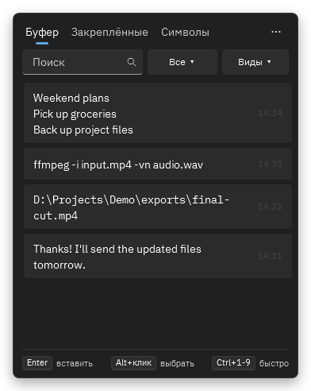
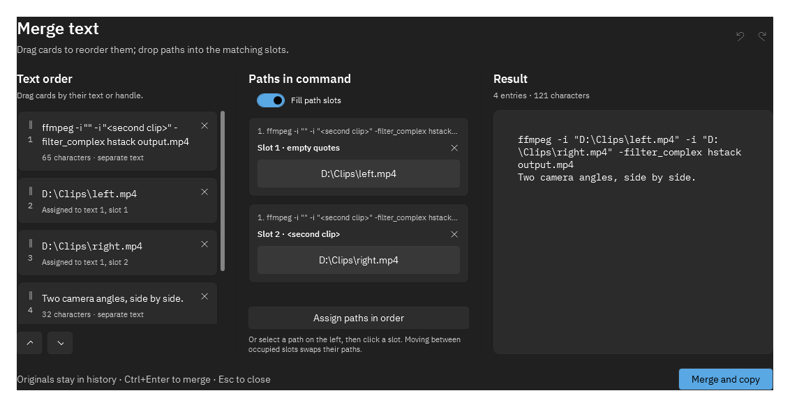
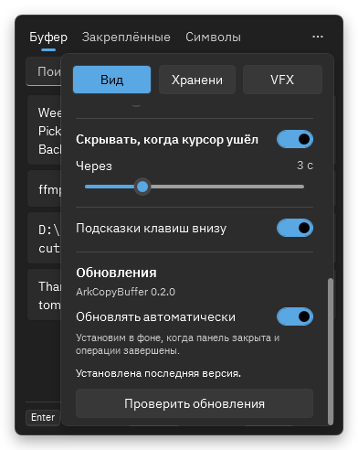

# CopyBuffalo

Clipboard history for Windows. Copy text, images, and files, then press **Win+V** to find and paste them again.

The software is called **CopyBuffalo**. Existing downloads and internal file/storage names retain `ArkCopyBuffer` for compatibility with installed versions.

**[Download for Windows](https://github.com/Arkanoidvfx/CopyBuffalo/releases/latest/download/ArkCopyBuffer-Setup.exe)** · [All downloads](https://github.com/Arkanoidvfx/CopyBuffalo/releases/latest) · [Report a bug](https://github.com/Arkanoidvfx/CopyBuffalo/issues)

Windows 10 (1809+) or Windows 11 · Intel/AMD x64 · English, Russian, Simplified Chinese, Traditional Chinese, Japanese, and Hindi interface.

## Get started

1. Download and run **ArkCopyBuffer-Setup.exe**. No administrator access is needed; .NET, FFmpeg, and OCR are included.
2. Copy something, then press **Win+V**. Click an entry or select it and press **Enter** to paste.
3. Open **⋯** or the tray menu for settings, pause, and exit. Exiting restores the usual Windows Win+V shortcut.

Updates are **on by default**. They download in the background and install when the panel is closed and pending work has finished. History, settings, and installed AI files are kept.

## Everyday use

- Search your history, filter by app or content type, and pin items in groups.
- Keep text formatting, paste plain text, or edit a saved entry.
- Extract text from screenshots with local OCR.
- **Alt+click** to start selecting multiple entries. Combine text, fill paths into a command, or queue images and videos for pasting.
- Turn folders into ZIP files or extract audio from video.

### Combine text and file paths

Reorder the selected entries, put paths into placeholders, and check the result before copying.

### Choose when to update

Open **⋯ → Settings → View**, then scroll to **Updates**. You can disable automatic updates or check manually. English is the default; choose your interface language at the top of this page and restart the app to apply it. Chinese, Japanese, and Hindi fonts are bundled.

Screenshots use sample data, rendered from the app's own controls.

## Optional local AI

Prompt compression and translation of image labels into Russian need the full package. On the [release page](https://github.com/Arkanoidvfx/CopyBuffalo/releases/latest), download **both** `ArkCopyBuffer-Full-Setup.exe.part1` and `.part2`, plus **Install-Full.cmd**, into the same folder. Run the CMD file; it assembles and verifies the installer before opening it.

The full download is about 3.5 GB. Allow another 3.5 GB to assemble it, plus installation space. It includes the model and CPU/NVIDIA runtime. Later app updates use the smaller standard installer.

## Your data

History stays in `%LOCALAPPDATA%\ArkCopyBuffer`, encrypted for your Windows account. Settings are stored separately from the app. OCR and bundled AI run locally; update checks and downloads contact GitHub.

Clipboard history can contain sensitive information. Pause recording from the tray menu when needed. Encryption does not hide it from other programs running as your Windows user.

For builds, tests, and release packaging, see [Development](docs/development.md).

## License

CopyBuffalo's original source code is available under the [MIT License](LICENSE), allowing commercial use, modification, and redistribution with the copyright and license notice retained. Bundled components retain their own licenses; see [Third-party notices](packaging/THIRD-PARTY-NOTICES.txt).
