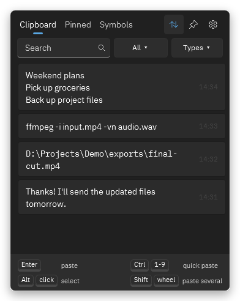
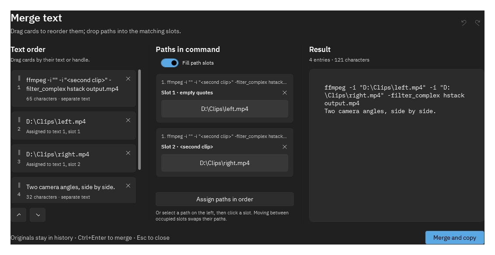
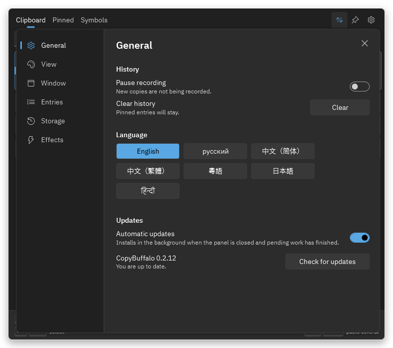

# CopyBuffalo

Clipboard history for Windows. Copy text, images, and files, then press **Win+V** to find and paste them again.

The software is called **CopyBuffalo**. Existing downloads and internal file/storage names retain `ArkCopyBuffer` for compatibility with installed versions.

**[Download for Windows](https://github.com/Arkanoidvfx/CopyBuffalo/releases/latest/download/CopyBuffalo-Setup.exe)** · [All downloads](https://github.com/Arkanoidvfx/CopyBuffalo/releases/latest) · [Report a bug](https://github.com/Arkanoidvfx/CopyBuffalo/issues)

Windows 10 (1809+) or Windows 11 · Intel/AMD x64 · English, Russian, Simplified Chinese, Traditional Chinese, Cantonese, Japanese, and Hindi interface.

## Get started

1. Download and run **CopyBuffalo-Setup.exe**. No administrator access is needed; .NET, FFmpeg, and OCR are included.
2. Copy something, then press **Win+V**. Click an entry or select it and press **Enter** to paste.
3. Open the gear for settings, pausing, and clearing the history. The tray menu has them too, with exit. Exiting restores the usual Windows Win+V shortcut.

Updates are **on by default**. They download in the background and install when the panel is closed and pending work has finished. History, settings, and installed AI files are kept.

## Everyday use

- Search your history, filter by app or content type, and pin items in groups.
- Right-click an entry → **Open history map** to explore retained entries by day, preview them, and copy them. [History Map guide](docs/history-map.md).
- Use the pencil or **F2** to edit a saved text entry. Use the save button to finish or the copy button to save and copy the whole entry. In **Settings → Entries**, enable **Hold a row to edit** to use a long press in place of the pencil.
- Hover over or select an image and press **F11**, or choose **Full screen** from its menu. F11 works before the hover preview appears. Press **Esc** to return to the panel.
- In the full text editor, press **Ctrl+H** to find and replace every literal match in the current text. **Ctrl+Z** undoes the replacement.
- While editing a settings field, press **Win+V** and choose a text entry. CopyBuffalo copies it and returns to the same field. Press **Ctrl+V** to paste.
- Under **Settings → View**, adjust panel background and entry text transparency independently or link them. In **Settings → Entries**, enable **Replace text on copy and paste** to apply a recurring rule when pasting from the panel or using **Copy** in quick edit. For example, set **Find** to `ЯС42-` and **Replace with** to `ЯС42вн` to convert document numbers while keeping other hyphens. Leave **Replace with** blank to remove the match. The rule changes the outgoing plain text and keeps the saved entry as edited.
- **Ctrl+click** or **Ctrl+Enter** to paste text or a folder path in double quotes.
- Extract text from screenshots with local OCR.
- **Alt+click** to start selecting multiple entries. Combine text, fill paths into a command, or queue images and videos for pasting.
- Point at an entry, hold **Shift** and roll the wheel up or down to collect entries from it. Release **Shift** to paste them all at once.
- Turn folders into ZIP files or extract audio from video.
- Drag an edge or corner of the panel to resize it. It opens at its normal size again next time.
- Pasting an entry leaves it where it is in the list. Turn off the arrows button next to the pin on the **Clipboard** tab to move pasted entries to the top instead.
- Click the pin next to the gear to keep the panel on screen while you work in other windows; its edge glows while pinned. **Esc** closes it, **Win+V** returns the keyboard to it, and pasting goes to the window you used last.

### Combine text and file paths

Reorder the selected entries, put paths into placeholders, and check the result before copying.

### Choose when to update

Open **Settings → General** for **Updates**. You can disable automatic updates or check manually. English is the default; choose your interface language on this page and restart the app to apply it. Chinese, Japanese, and Hindi fonts are bundled.

Screenshots use sample data, rendered from the app's own controls.

## Optional local AI

Prompt compression, grammar fixes, and translation of image labels into Russian need the full package. **[Download the AI setup launcher](https://github.com/Arkanoidvfx/CopyBuffalo/releases/latest/download/CopyBuffalo-Full-Setup.cmd)** and run it. It downloads both package parts, verifies SHA-256, and opens the full installer. For offline installation, download both `CopyBuffalo-Full-Setup.exe.part1` and `.part2` from the [release page](https://github.com/Arkanoidvfx/CopyBuffalo/releases/latest) beside the CMD file.

The full download is about 3.5 GB. Allow another 3.5 GB to assemble it, plus installation space. It includes the model and CPU/NVIDIA runtime. Later app updates use the smaller standard installer.

Versions 0.2.3 and older need one manual upgrade to 0.2.4 because the installer filename changed. Later versions update automatically using `CopyBuffalo-Setup.exe`.

## Your data

History stays in `%LOCALAPPDATA%\ArkCopyBuffer`, encrypted for your Windows account. Settings are stored separately from the app. OCR and bundled AI run locally; update checks and downloads contact GitHub.

Text marked sensitive or excluded from history by its source app is kept encrypted and shown as `********`. Hover over its card for two seconds to reveal the value directly in that card; leaving immediately restores the stars. Unmarked text is not guessed to be a password. A plain `http(s)` link is not treated as a password even when its source app excludes it from history, as browsers can for private windows; it stays readable and loses that exclusion when pasted from the panel. A link containing a login or a parameter such as `token=` stays masked.

Clipboard history can contain sensitive information. Pause recording from the tray menu when needed. Encryption does not hide it from other programs running as your Windows user.

For builds, tests, and release packaging, see [Development](docs/development.md).

## License

CopyBuffalo's original source code is available under the [MIT License](LICENSE), allowing commercial use, modification, and redistribution with the copyright and license notice retained. Bundled components retain their own licenses; see [Third-party notices](packaging/THIRD-PARTY-NOTICES.txt).
